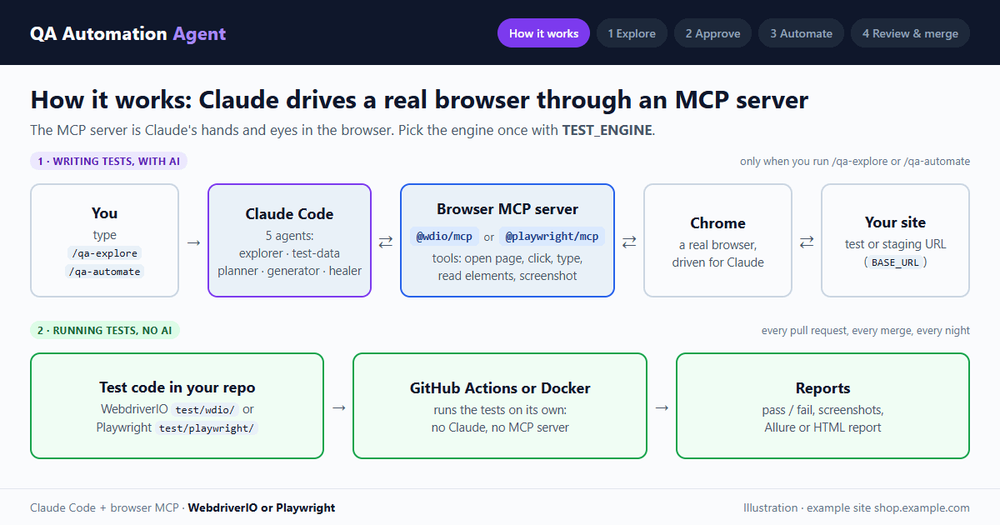
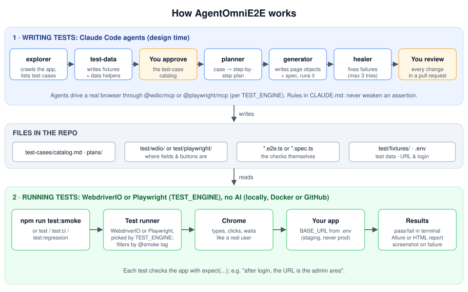

# AgentOmniE2E — an AI agent for 100% end-to-end UI test coverage (WebdriverIO or Playwright)

AI agents (Claude Code + a browser MCP server) discover test cases from an app URL, prepare test
data, and write end-to-end tests. CI runs the tests as plain code, with no AI at run time.



<sub>How it works (Claude Code + the `@wdio/mcp` or `@playwright/mcp` browser server) → explore → approve → automate → review & merge. Illustration on an example site.</sub>

> ⚠️ **Choose either WebdriverIO or Playwright based on your need, not both.**
> The project supports both engines, but each project should use **one**. Set it once with
> `TEST_ENGINE` (`wdio` or `playwright`). Running both doubles the tests you write and maintain.
> See [Choose your test engine](#choose-your-test-engine).

**New here and want this for your own site?** Follow **[How to use this for your own project](HOW-TO-USE.md)**:
a step-by-step guide from getting your own copy to tests running on GitHub every night.

## Contents

- [How it works](#how-it-works)
- [Choose your test engine](#choose-your-test-engine)
- [Setup](#setup)
- [Using the agents](#using-the-agents-explore--approve--automate--publish)
- [One-time GitHub setup](#one-time-github-setup)
- [Sites with a login (optional)](#sites-with-a-login-optional)
- [Run with Docker (optional)](#run-with-docker-optional)
- [Already have tests in another repo?](#already-have-webdriverio-or-playwright-tests-in-another-repo)
- [Does it need Claude, and does it cost anything?](#does-it-need-claude-and-does-it-cost-anything)
- [Troubleshooting](#troubleshooting)
- [Layout](#layout)
- [Next phase: Claude Agent SDK](#next-phase-move-from-the-claude-code-cli-to-the-claude-agent-sdk)

## How it works

This is an automated website-testing framework. It opens Chrome, clicks and types like a real
user, and checks that the app responds correctly, e.g. "after login, the dashboard is shown". It
works in two halves:

1. **Writing tests (AI-assisted).** Claude Code agents explore the app, list test cases, and,
   after you approve them, write the page objects and specs for your chosen engine. They fix
   failing tests by changing only locators and waits, never the expected results. Every change
   goes through a pull request.
2. **Running tests (no AI).** `npm run test:*` starts the engine set in `TEST_ENGINE`, which drives
   Chrome against `BASE_URL` and reports pass/fail, with a screenshot of any failure.



The flow is the same for both engines; only the browser server (`@wdio/mcp` or `@playwright/mcp`)
and the test runner change with `TEST_ENGINE`.

### The role of the browser MCP server

The browser MCP server is **Claude's hands and eyes in the browser**. Claude can't open a website
by itself. The server gives it browser tools it can call, and drives a real Chrome window on its
behalf. It's `@wdio/mcp` for WebdriverIO and `@playwright/mcp` for Playwright.

```
Claude Code  →  calls tools (navigate, click, read elements)  →  browser MCP server  →  Chrome  →  your site
             ←  page details, element lists, screenshots       ←
```

| Step | How the MCP server is used |
| --- | --- |
| `/qa-explore` (explorer) | Claude opens each page, reads its menus, forms, buttons and tables, opens dialogs and tests validation, and takes screenshots. From that it works out the pages and proposes test cases. |
| `/qa-automate` (planner, generator) | Claude replays each test step live in the browser to confirm it works and to pick the most reliable selector for each element. |
| Healer | When a test fails, Claude reopens the page to see what changed (e.g. a renamed button) and fixes the selector. |

**It's only used while generating tests.** The finished tests are ordinary WebdriverIO or Playwright
code. When they run, locally or on GitHub, neither the MCP server nor Claude is involved.

Both servers are set up in [`.mcp.json`](.mcp.json), which starts them when Claude Code opens in
this folder. That's why Claude Code must be started here.

## Choose your test engine

| | **WebdriverIO** (`TEST_ENGINE=wdio`, default) | **Playwright** (`TEST_ENGINE=playwright`) |
| --- | --- | --- |
| Pick it when | Your team already knows WebdriverIO, needs the WebDriver protocol (e.g. Selenium Grid, cloud device farms), or mobile/Appium later | You want built-in auto-waiting, isolated parallel workers, and trace files for debugging failures |
| Tests and page objects | `test/wdio/specs/*.e2e.ts`, `test/wdio/pageobjects/` | `test/playwright/specs/*.spec.ts`, `test/playwright/pages/` |
| Config | `wdio.conf.ts`, `wdio.ci.conf.ts` | `playwright.config.ts` |
| Report | Allure (`reports/allure-results`), failure screenshots in `reports/screenshots` | HTML (`reports/playwright-report`), screenshots and traces in `reports/playwright-results` |
| Agents' browser tools | `@wdio/mcp` (`wdio-mcp`) | `@playwright/mcp` (`playwright-mcp`) |
| Conventions | `.claude/skills/wdio-conventions/` | `.claude/skills/playwright-conventions/` |

**Shared by both:** test data and helpers (`test/helpers/`, and `test/fixtures/` once the test-data
agent creates it), the catalog (`test-cases/`), plans, the approval flow, the publish script, Docker
and the GitHub workflows.

**How to switch:**
1. Set `TEST_ENGINE=playwright` (or `wdio`) in `.env`, and the same as a GitHub repository
   *variable* (**Settings → Secrets and variables → Actions → Variables**).
2. Run `/qa-automate` to generate tests for that engine. Existing tests are **not** converted
   automatically; tests written for the other engine stay in its folder and are ignored.
3. Once you've settled on an engine, delete the other engine's `test/` folder and config so
   nobody maintains two suites.

Each engine has one example test (`TC-EXAMPLE-001`: the home page opens with a title and visible
content). It works on any site and shows the structure generated tests follow.

## Setup

### What you need

| Tool | Why | Check it's installed |
| --- | --- | --- |
| [Node.js](https://nodejs.org) 22.23.4+ or 24.22.1+ (latest 22 or 24 recommended) | Runs the tests. WebdriverIO 10 needs these versions; Node 20 and older are not supported. | `node -v` |
| Google Chrome | The browser both engines drive. Playwright uses it too, so no extra browser download. | — |
| Git | Publishing tests to GitHub | `git --version` |
| Claude Code, with a Claude account | Only for **generating** tests (`/qa-explore`, `/qa-automate`). Not needed to run them. | `claude --version` |

### 1. Install Claude Code (only if you'll generate tests)

The **VS Code extension** gives you the chat panel. The **command-line tool** lets you type
`claude` in a terminal. The extension alone does not provide the `claude` terminal command.

```powershell
# Windows (PowerShell)
irm https://claude.ai/install.ps1 | iex
# or, on any OS with Node.js:
npm install -g @anthropic-ai/claude-code
```

Close and reopen the terminal, then run `claude` once and sign in.

### 2. Install the project

Run every command **from the project folder** (the one containing `package.json`), not the folder
above it.

```powershell
npm install
Copy-Item .env.example .env      # macOS/Linux: cp .env.example .env
```

### 3. Fill in `.env`

| Setting | What to put | Needed for |
| --- | --- | --- |
| `TEST_ENGINE` | `wdio` (default) or `playwright`. One engine per project. | Always |
| `BASE_URL` | The site to test. Use a test or staging site, **never production**. | Always |
| `TEST_USER`, `TEST_PASSWORD` | A test account, only if the site has a login. Otherwise leave empty. | Sites with a login |
| `HEADLESS` | `true` hides the browser window, `false` shows it | Optional |
| `MAX_INSTANCES` | How many browsers run in parallel (default 2 locally, 4 in CI mode) | Optional |
| `GITHUB_REPO`, `GITHUB_TOKEN` | Where tests are published (see [One-time GitHub setup](#one-time-github-setup)) | Publishing |
| `GITHUB_BASE_BRANCH` | Branch pull requests target (default `main`) | Optional |

`.env` holds passwords and tokens. It is never committed or published.

### 4. Check it works

```powershell
npm run test:smoke
```

Chrome opens your site and runs the example test (`TC-EXAMPLE-001`). If it passes, the setup works.
If not, see [Troubleshooting](#troubleshooting).

### Commands

| Command | What it does |
| --- | --- |
| `npm run test` | All tests, with the engine in `TEST_ENGINE` |
| `npm run test:smoke` / `test:regression` | Only `@smoke` / `@regression` tests |
| `npm run test:ci` / `test:ci:smoke` | CI settings: headless, one retry, JUnit output |
| `npm run report` | Open the report (Allure for WDIO, HTML for Playwright) |
| `npm run test:wdio` / `npm run test:pw` | Force one engine for a single run, ignoring `TEST_ENGINE` |
| `npm run test -- <args>` | Pass extra arguments to the engine, e.g. a single spec file |
| `npm run qa:publish -- --branch qa/<name> --title "<title>" --body-file <file>` | Push a `qa/…` branch and open a pull request. `--body-file` takes a **file path**. |

## Using the agents: explore → approve → automate → publish

Open Claude Code **in the project folder** (so it loads `.claude/` and `.mcp.json`), then:

| Step | You do | What happens |
| --- | --- | --- |
| 1 | Run `/qa-explore` | The explorer finds every page (menus, links, sitemap, dialogs) and writes `test-cases/catalog.md`: a page inventory plus proposed test cases. The test-data agent writes fixtures. It then **stops**. The catalog is the same for both engines. |
| 2 | Open `test-cases/catalog.md` and set each case's **Status** to `approved` or `rejected` | Nothing runs until you approve. Leave a case as `new` to decide later. Or ask Claude, e.g. *"approve all P1 cases"*. |
| 3 | Run `/qa-automate` | For approved cases: planner → generator → healer, writing tests **only for the engine in `TEST_ENGINE`**, then the full suite runs locally. Suspected app bugs are skipped with a `BUG?` note, never hidden. |
| 4 | Review and merge the pull request it opens | The tests are pushed to `GITHUB_REPO` on a `qa/…` branch with a PR. Nothing goes to `main` without your merge. |
| 5 | Nothing | GitHub Actions runs smoke tests on every PR, all tests on every merge to `main` and nightly, with no AI. Reports are attached to each run. |

**Priorities in the catalog:** P1 = the page works at all (good smoke tests), P2 = important
variations, P3 = edge cases. Start by approving P1.

**Scope a run:** `/qa-explore only the Orders and Checkout pages`, `/qa-automate TC-HOME-001 to TC-HOME-005`.

**Safety:** agents may create records only with the `QA-AUTO-` prefix and delete them again. They
never edit, approve, sign off, delete, re-run or send existing data.

### Running it from a terminal instead of the chat window

With the command-line tool installed, you can run each step as a single command:

```powershell
claude -p "/qa-explore" --permission-mode acceptEdits --allowedTools "Bash(npm *)" "Bash(npx *)" "Bash(node *)" "mcp__wdio-mcp" "mcp__playwright-mcp"
# edit test-cases/catalog.md and approve cases (step 2)
claude -p "/qa-automate" --permission-mode acceptEdits --allowedTools "Bash(npm *)" "Bash(npx *)" "Bash(node *)" "Bash(git *)" "mcp__wdio-mcp" "mcp__playwright-mcp"
```

There is no chat window to ask "may I run this?", so the flags grant those permissions up front.
`acceptEdits` lets Claude write files; the `--allowedTools` entries let it run the tests, use git
and drive the browser. Without them, the run stops at the first action that needs permission.

## One-time GitHub setup

1. Create the repository (empty is fine), and a **fine-grained token** limited to it with
   *Contents*, *Pull requests* and *Workflows* set to **Read and write** (classic token: `repo` +
   `workflow`). Without *Workflows*, GitHub rejects pushes that include `.github/workflows/`. For an
   organisation repo, an admin may need to approve the token; with single sign-on, click
   **Configure SSO → Authorize** on the token.
2. Add to `.env`: `GITHUB_REPO=https://github.com/<owner>/<repo>` and `GITHUB_TOKEN=<token>`.
   `GITHUB_REPO` must be the same repository as git's `origin` remote.
3. Make sure git knows who you are: `git config --global user.name "…"` and
   `git config --global user.email "…"`.
4. In the repo's **Settings → Secrets and variables → Actions**:
   - **Secrets:** `BASE_URL` (always), plus `TEST_USER` / `TEST_PASSWORD` if the app needs a login.
     GitHub never sees your `.env`. Without `BASE_URL`, every run fails with `ERR_NAME_NOT_RESOLVED`
     or `Invalid URL`.
   - **Variables:** `TEST_ENGINE` = `wdio` or `playwright` (default `wdio` if not set).
5. If the repository is empty, the first `/qa-automate` asks you to confirm a one-off push of the
   framework to `main` (`npm run qa:publish -- --bootstrap`). Everything after that goes through PRs.

**About the schedule** (`.github/workflows/e2e.yml`): `30 20 * * *` is **UTC** (02:00 IST). Scheduled
runs start only from the default branch, and on public repositories GitHub pauses them after 60 days
without activity; a commit or a manual run (**Actions → E2E tests → Run workflow**) turns them back on.

To skip the GitHub runs for a single commit, add `[skip ci]` to its commit message.

## Sites with a login (optional)

Skip this section if your site opens without signing in: leave `TEST_USER` / `TEST_PASSWORD` empty
and don't add them as GitHub secrets. Only `BASE_URL` is required.

If the site has a login, the credentials go in **two places**, and **never in any other file**
(README, fixtures, plans, code):

| Where tests run | Where the credentials go |
| --- | --- |
| Your machine | `.env`: `TEST_USER=<username>` and `TEST_PASSWORD=<password>` |
| GitHub Actions | Repository secrets `TEST_USER` and `TEST_PASSWORD` |

Use a **dedicated test account** on a test or staging site, not a personal account. If the password
is ever exposed, change it on the site and update both places.

The explorer signs in with these credentials only when it finds a sign-in form, and the generated
tests include a sign-in step when the site needs one. If a login is added **after** the tests were
generated, ask Claude: *"the site now has a login at &lt;URL&gt;; add a shared sign-in step using
TEST_USER and TEST_PASSWORD"*.

For a **company single sign-on page** (Microsoft, Okta…), a plain username and password may not
work, e.g. because of MFA. Use a dedicated test account without MFA, or a saved session, and agree
the approach with your identity team.

## Run with Docker (optional)

Docker runs the tests in the same kind of Linux environment GitHub Actions uses. Your normal
`npm run …` commands still work; Docker is an extra option. The image contains both engines and
Google Chrome; `TEST_ENGINE` in your `--env-file` picks the engine.

**Every push to GitHub builds the image** (`.github/workflows/docker.yml`) and publishes it to
GitHub Container Registry as `ghcr.io/<owner>/<repo>`, tagged with the commit SHA, the branch name
(with `/` replaced by `-`, e.g. `qa-engine-switch`), and `latest` for `main`. The image contains no
secrets.

**Run it locally** (Docker Desktop must be running), from the project folder:

```powershell
# Build the image (once, or after code changes)
docker build -t qa-agent .

# Run the CI suite, passing your .env settings at run time (never baked into the image)
docker run --rm --env-file .env -v ${PWD}/reports:/app/reports qa-agent

# Run only the @smoke tests instead
docker run --rm --env-file .env -v ${PWD}/reports:/app/reports qa-agent npm run test:ci:smoke
```

`${PWD}` is the current folder in PowerShell (use `%cd%` in Command Prompt, `$(pwd)` in Git Bash).
Reports land in your local `reports/` folder. If Chrome crashes on a bigger suite, add
`--shm-size=2g` to the `docker run` command.

**Use the published image** (after the first successful workflow run; you may need to make the
package visible under the repo's **Packages** settings):

```powershell
docker pull ghcr.io/<owner>/<repo>:latest
docker run --rm --env-file .env -v ${PWD}/reports:/app/reports ghcr.io/<owner>/<repo>:latest
```

### If you only have the image (no repo)

The image contains no settings and no secrets. Each person supplies their own, in a file called
`.env` on their own machine.

1. **Log in to GitHub Container Registry** (only needed if the package is private). Create a GitHub
   token with the `read:packages` scope, then run:
   ```powershell
   docker login ghcr.io -u <your-github-username>
   # paste the token when asked for a password
   ```
   You also need to be a member of the repository, or the package must be shared with you.
2. **Get the template settings.** Either copy `.env.example` from the repository, or create a file
   named `.env` with these lines:
   ```
   TEST_ENGINE=wdio
   BASE_URL=https://<the-site-to-test>
   # Only if the site has a login:
   TEST_USER=<test-account-username>
   TEST_PASSWORD=<test-account-password>
   ```
   Use the same `TEST_ENGINE` the repository's tests were written for. `GITHUB_TOKEN` and
   `GITHUB_REPO` are only for publishing, so they're not needed to run tests.
3. **Pull and run** from the folder that contains `.env`:
   ```powershell
   docker pull ghcr.io/<owner>/<repo>:latest
   docker run --rm --env-file .env -v ${PWD}/reports:/app/reports ghcr.io/<owner>/<repo>:latest
   ```
4. **Find the reports** in the `reports` folder created next to `.env`. WebdriverIO failure
   screenshots are in `reports/screenshots`; Playwright's are in `reports/playwright-results`.

Keep `.env` private: it holds passwords. Never add it to the image or commit it.

**Notes**
- `.env` is excluded from the image by `.dockerignore`. Pass it with `--env-file`.
- Inside a container, `localhost` is the container itself. Use the real site URL in `BASE_URL`.
- The Claude agents (`/qa-explore`, `/qa-automate`) are not part of the test run. Run them with
  Claude Code on your machine, as before.

## Already have WebdriverIO or Playwright tests in another repo?

The explore → approve → automate flow works the same either way. What changes is where the tests
live and whose conventions the agents follow.

**Option 1: bring the agents into your existing repo (recommended).** Copy the AI parts into it:
`.claude/`, `CLAUDE.md`, `.mcp.json`, `test-cases/`, `plans/` and `scripts/`. Your existing tests,
config and CI stay as they are. Then:
- set `TEST_ENGINE` to match the repo (`wdio` or `playwright`)
- point `CLAUDE.md` and the conventions skill at your own test folders and config files
- use one of your existing tests as the gold-standard example, so new tests match your style,
  selectors and helpers
- tell the explorer where your specs are, so already-automated cases are marked `automated` or
  `duplicate` instead of being generated again

**Option 2: move your tests into this repo.** Put them in `test/wdio/` or `test/playwright/` and
merge your config (services, hooks, reporters, login steps) into ours. More work, and the history is
lost unless you use something like `git subtree`. Only worth it if this repo becomes the main one.

**Option 3: keep both repos and copy generated tests across.** Not recommended: the two drift apart,
and the agents can't see or reuse your existing page objects.

**In every case:**
- **One engine per repo.** If your existing suite is WebdriverIO, keep `TEST_ENGINE=wdio`; don't add
  Playwright alongside it.
- **Agents don't change your existing tests**, unless you ask or the healer is fixing a failing one.
  They only add tests for approved cases.
- **Your CI keeps working.** New tests run with your existing commands.

### Separate test repo, or a folder inside the code repo?

| | Folder inside the code repo (e.g. `e2e/`) | Separate test repo (this layout) |
| --- | --- | --- |
| Pick it when | One application, and developers maintain the tests with their features | The testbed is shared by several apps or services, or QA owns the tests |
| Main benefit | Tests change in the same pull request as the code and can block a merge that breaks a journey | Test changes don't clutter the code repo or depend on its release cycle |
| Downside | Every code PR also runs the end-to-end tests (slower) | Tests can fall behind the app; nothing stops a code change from breaking them |

### Setting it up inside a code repo

1. **Copy the framework into a folder**, e.g. `<code-repo>/e2e/`, for **one engine only**:
   - copy `.claude/`, `CLAUDE.md`, `.mcp.json`, `scripts/`, `test/helpers/`, your engine's folder
     (`test/wdio/` or `test/playwright/`, base page and example only) and config, `package.json`,
     `package-lock.json`, `tsconfig.json`, `.env.example`, `.gitignore`, `test-cases/README.md`,
     `plans/README.md`, and optionally `Dockerfile` and `.dockerignore`
   - don't copy `.env`, `node_modules/`, `reports/`, `.git/`, `test-cases/catalog.md`, `plans/*.md`,
     `test/fixtures/*.json` (site-specific), or the other engine's folder and config
   - keep the tests' own `package.json` in `e2e/`, so app and test dependencies don't mix
2. **Move the workflows to the repository's top level.** GitHub only reads
   `<code-repo>/.github/workflows/`. Copy `e2e.yml` (and `docker.yml` if you want the image) there,
   set `E2E_DIR: 'e2e'` at the top of each, and uncomment the `paths:` filter so code-only changes
   that can't affect the tests don't start them.
3. **Work from the folder.** Run `npm install`, create `.env`, and run `npm run test:smoke` inside
   `e2e/`. Open Claude Code in `e2e/` so it loads the agents and `.mcp.json`. If the code repo has
   its own `CLAUDE.md`, Claude also reads it; the test rules in `e2e/CLAUDE.md` add to it.
4. **Publish from the folder.** `npm run qa:publish -- …` run inside `e2e/` detects that it is in a
   subfolder: it commits **only** `e2e/`, leaves changes elsewhere in the repository untouched, never
   creates a second repository, and accepts the repo's existing `origin` remote (https or ssh). It
   switches you to the `qa/…` branch and prints the command to switch back.

> **Note: remaining gap.** The agents and `scripts/run-tests.mjs` still assume fixed folders
> (`test/wdio/…` and `test/playwright/…`) and config file names. To use your **existing** test
> layout (Option 1), edit those paths in the agent instructions, `CLAUDE.md`, the conventions skills
> and the runner script. A planned improvement is a small settings file (spec folder, page-object
> folder, config file) that you point at your layout, with no edits to the agent instructions.
> Subfolders themselves are supported: publishing and the GitHub workflows work from `e2e/`.

## Does it need Claude, and does it cost anything?

Only **generating** tests uses Claude. Once written, the tests are ordinary code.

| Task | Uses Claude? | Cost |
| --- | --- | --- |
| `/qa-explore`: finding pages and proposing test cases | Yes | Uses your Claude usage |
| `/qa-automate`: writing and fixing tests | Yes | Uses your Claude usage |
| Approving test cases (editing `catalog.md`) | No | Free |
| Running tests (`npm run test`, Docker, the GitHub runs) | No | No Claude cost. GitHub Actions minutes may count against your GitHub plan for private repositories. |

How Claude usage is charged depends on how you sign in:

- **Claude subscription** (Pro, Max, or a Team/Enterprise seat): no extra charge per run. It counts
  towards your plan's usage limits. Your Claude admin can confirm which plan you're on.
- **Anthropic API key** (e.g. with `claude -p` set up with a key, or the SDK): **pay per use**, based
  on how much text Claude reads and writes.

What uses the most:

- **`/qa-explore`** is the heaviest. It reads every page, so the cost grows with the size of the site.
  It's usually needed once per site, and again only after big changes.
- **`/qa-automate`** grows with the number of approved cases and any repair attempts.
- **Everyday test runs** (locally, in Docker and on GitHub) use **no** Claude.

To keep usage down, work one section at a time (`/qa-explore only the Orders pages`) and start by
approving the P1 cases. After a run, type `/cost` or `/usage` in Claude Code to see what it used.
With an API key, check the Anthropic Console.

## Troubleshooting

| Problem | Fix |
| --- | --- |
| `wdio` or `playwright` is "not recognized" / "not found" | Dependencies aren't installed. Run `npm install` in the project folder, the one containing `package.json`, not the folder above it. |
| `claude` is "not recognized" in the terminal | Only the VS Code extension is installed. Install the command-line tool (Setup, step 1), then open a new terminal. |
| `/qa-explore` or `/qa-automate` is not found | Claude Code was started in the wrong folder. Start it in the project folder. |
| `TEST_ENGINE must be one of wdio, playwright` | Fix the spelling of `TEST_ENGINE` in `.env` (or the GitHub variable). |
| Tests run with the wrong engine | `TEST_ENGINE` is missing (defaults to `wdio`) or different on GitHub. Set it in `.env` **and** as a GitHub repository variable. |
| Playwright: "Chromium distribution 'chrome' is not found" | Google Chrome isn't installed. Install it, or run `npx playwright install chrome`. |
| `Error: No tests found` (Playwright) | No test matches the tag, e.g. no `@regression` tests yet. |
| Tests open `http://localhost:3000` | There's no `.env`. Copy `.env.example` to `.env` and set `BASE_URL`. |
| GitHub runs fail with `ERR_NAME_NOT_RESOLVED`, `Invalid URL` or `BASE_URL is not set` | The `BASE_URL` repository secret is missing. See [One-time GitHub setup](#one-time-github-setup). |
| GitHub runs time out in many tests at once | Too many parallel browsers for the runner, or the site is slow. Lower `MAX_INSTANCES` in CI. |
| `git user is not configured` from `npm run qa:publish` | Run `git config --global user.name "…"` and `git config --global user.email "…"`. |
| `the "origin" remote points to …` from `npm run qa:publish` | `GITHUB_REPO` in `.env` and git's `origin` remote name different repositories. Make them match. |
| `Unknown option '--body-file:…'` | `--body-file` takes a file path after a space, e.g. `--body-file reports/pr-body.md`, not the description text. |

Install notes: `npm install` reports known vulnerabilities in the dev tooling. Avoid
`npm audit fix --force`, which can install breaking major versions. npm may also hold back install
scripts for `edgedriver`, `geckodriver` and `esbuild` pending approval. Chrome runs are not
affected.

## Layout

| Path | Purpose |
| --- | --- |
| `README.md`, `HOW-TO-USE.md` | This reference, and the step-by-step guide for your own project |
| `CLAUDE.md` | House rules every agent follows, including the one-engine rule |
| `.mcp.json` | Registers both browser servers: `wdio-mcp` and `playwright-mcp` |
| `.claude/agents/` | explorer, test-data, planner, generator, healer (engine-aware) |
| `.claude/skills/qa-explore/`, `qa-automate/` | The `/qa-explore` and `/qa-automate` commands |
| `.claude/skills/wdio-conventions/`, `playwright-conventions/` | Coding conventions + gold-standard examples per engine |
| `scripts/run-tests.mjs` | Runs the tests with the engine in `TEST_ENGINE` (behind every `npm run test*`) |
| `scripts/publish.mjs` | `npm run qa:publish`: branch, commit, push, open PR (token from `.env`); works at the repo root or in a subfolder |
| `test-cases/` | Discovered catalog (`catalog.md`, written by `/qa-explore`) and imported manual cases (shared) |
| `plans/` | Step-by-step plans written by the planner (shared) |
| `test/wdio/` | WebdriverIO page objects (`pageobjects/`) and specs (`specs/*.e2e.ts`) |
| `test/playwright/` | Playwright page objects (`pages/`) and specs (`specs/*.spec.ts`) |
| `test/helpers/data/` | `loadFixture()`, unique values, setup/cleanup helpers (shared) |
| `test/fixtures/` | Synthetic test data keyed by case ID, created by the test-data agent (shared) |
| `wdio.conf.ts` / `wdio.ci.conf.ts` | WebdriverIO local and CI configs |
| `playwright.config.ts` | Playwright config (CI mode via `npm run test:ci`) |
| `Dockerfile`, `.dockerignore` | Test image with both engines and Google Chrome |
| `docs/` | Diagram (`how-it-works.svg`) and the demo animation (`demo.gif`) shown at the top of this README |
| `.github/workflows/e2e.yml` | Smoke on PRs, full regression on main and nightly (engine from `TEST_ENGINE` variable, folder from `E2E_DIR`) |
| `.github/workflows/docker.yml` | Builds and publishes the Docker image on every push |
| `reports/` | Test output (not committed) |

## Next phase: move from the Claude Code CLI to the Claude Agent SDK

**Today**, the pipeline runs through Claude Code: someone opens it, or runs `claude -p`, and types
`/qa-explore` or `/qa-automate`.

**Next**, run the same pipeline from our own code using the **Claude Agent SDK** (TypeScript or
Python). The SDK is the same engine as Claude Code, called from a script instead of the `claude`
command.

### What carries over unchanged

- The agents in `.claude/agents/` (explorer, test-data, planner, generator, healer)
- The `/qa-explore` and `/qa-automate` steps, and the house rules in `CLAUDE.md`
- Both browser MCP servers, both engines, the publish script, Docker and the GitHub workflows

The new piece is a small script, e.g. `scripts/qa.ts`, that starts the explore and automate runs.

### What we gain

- **No Claude Code install** for the people using it
- **Our own front end:** a web page with an approval screen, a Jira or GitHub trigger, or a scheduled job
- **Permissions in code,** so runs are unattended, with exactly the tools each step may use
- **Telemetry:** every agent run can be traced, e.g. in Langfuse (prompts, tool calls, cost, failures)

### What changes

- **Billing:** runs use an **Anthropic API key and are paid per use**, instead of counting towards a
  Claude subscription. The same cost drivers apply: exploring is the heaviest, automating grows with
  the number of approved cases.
- **Maintenance:** we own and maintain the wrapper script and whatever front end we add.

### When to do it

Stay on the CLI while a few people run the pipeline by hand. Move to the SDK when it needs to run
as a service, in CI, or behind our own UI. Because the SDK only wraps what already exists, the
switch is small.

### Planned steps

1. Add `scripts/qa.ts`: run `/qa-explore` and `/qa-automate` through the SDK, loading this
   folder's agents, commands and `.mcp.json`, with an explicit tool allow-list.
2. Add `ANTHROPIC_API_KEY` to `.env` and as a GitHub secret.
3. Add a GitHub Actions workflow that runs explore and automate on demand, so the catalog and the
   tests both arrive as pull requests.
4. Add tracing (e.g. Langfuse) to see the cost and outcome of each run.
5. Optional: a simple internal page to approve test cases without editing `catalog.md`.
6. Optional: a settings file for the test folder and config paths (closes the remaining gap above).

## License

Released under the [MIT License](LICENSE). Free to use, modify and share.
